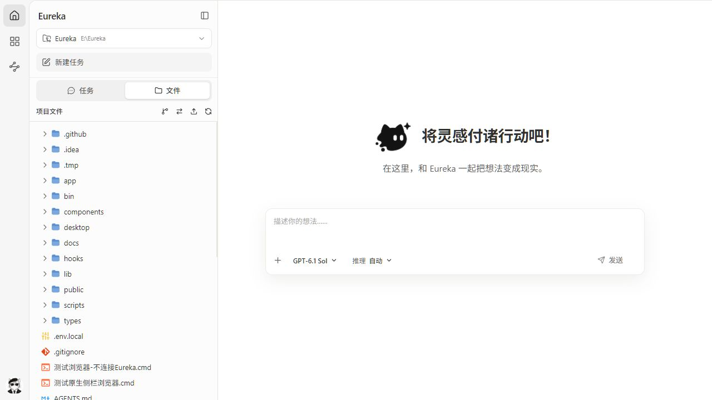

# Eureka

**One workspace for AI conversations, project files, business plugins, and reusable automations.**

[简体中文](./README.zh-CN.md) · [日本語](./README.ja.md) · [Русский](./README.ru.md)

Eureka is a local AI workspace built on the [pi coding agent](https://github.com/earendil-works/pi), with a **Windows desktop app and a browser interface**. Ask AI to explore projects, edit code, and process files; connect your organization's business tools; or turn repeated work into applications you can run again with new inputs.

Conversations and configuration are stored locally and shared with pi. Model inference and business queries use your configured model providers and plugin services.

[Download](https://github.com/is-zoop/Eureka/releases) · [Run from source](#run-from-source) · [Start using Eureka](#start-using-eureka) · [Report an issue](https://github.com/is-zoop/Eureka/issues)



## What can I use it for?

- **Work on projects.** Choose a working directory, ask AI to explain code, investigate problems, or edit files, and follow its tool calls in the conversation.
- **Use business tools.** Sign in with Haze to install organization-provided skills, MCP tools, and automation apps, then select them in a conversation.
- **Reuse repeated work.** Describe a file-processing, data, or website task; generate, test, and save an automation app; then run it again with different parameters.

Try requests such as:

> Read this project, explain its main modules, and identify the startup entry point.

> Summarize the data in the files I select and save the result in the project directory.

> Create an automation app that takes a list of text, removes blanks and duplicates, sorts it, and exports JSON. Test it and check the output before I save it.

File-processing capabilities depend on the selected model, tools, and plugins. Business queries require the relevant plugin and access rights. Automation authoring and website execution are under active development; test a specific task with a small sample first.

## Features

<table border="1" cellpadding="8" cellspacing="0" width="100%">
  <thead>
    <tr>
      <th align="left">Feature</th>
      <th align="left">What you can do</th>
    </tr>
  </thead>
  <tbody>
    <tr>
      <td><strong>AI conversations</strong></td>
      <td>Stream responses, thinking, and tool calls; choose models and thinking levels; answer clarification questions; use plan mode to work through a task</td>
    </tr>
    <tr>
      <td><strong>Projects and sessions</strong></td>
      <td>Group conversations by project; resume, rename, export, or delete them; inspect context usage and usage statistics</td>
    </tr>
    <tr>
      <td><strong>Conversation branches</strong></td>
      <td>Start an independent session from an earlier message, or edit and navigate branches within the current session</td>
    </tr>
    <tr>
      <td><strong>Files and Git</strong></td>
      <td>Reference files, folders, and images; browse project files and Git diffs; preview source, Markdown, images, audio, PDF, and DOCX</td>
    </tr>
    <tr>
      <td><strong>Model configuration</strong></td>
      <td>Manage provider sign-in and API keys, configure custom models, discover upstream models, and test connections</td>
    </tr>
    <tr>
      <td><strong>Plugins and skills</strong></td>
      <td>Install Haze organization plugins, manage skills and packages, select capabilities in the composer, and inspect session MCP status</td>
    </tr>
    <tr>
      <td><strong>Automation apps</strong></td>
      <td>Create, test, validate, and save apps in chat; run parameter forms; inspect workflow canvases, logs, results, and downloads; import/export ZIP packages and revise apps with AI</td>
    </tr>
    <tr>
      <td><strong>Desktop workspace</strong></td>
      <td>Handle website tasks in a side browser, manage separate browser environments and login data, and use the system tray and in-app updates</td>
    </tr>
    <tr>
      <td><strong>Git worktrees</strong></td>
      <td>Create and switch working copies while keeping sessions from the same repository grouped together</td>
    </tr>
  </tbody>
</table>

The interface supports English, Simplified Chinese, and light/dark themes.

## Quick start

### Windows desktop app

Use the desktop app for the full workspace, built-in browser, and website automation.

1. Download the Windows x64 installer (`*-setup.exe`) from [Releases](https://github.com/is-zoop/Eureka/releases) and install it.
2. Launch Eureka. Sign in with Haze, or choose **Skip login** to try basic chat and project file features.
3. Open **Settings → Models**, sign in to a model provider or add an API key, and select an available model.
4. Create a task, choose a working directory, and describe what you want to do.

The installer bundles the local service and Node.js runtime; you do not need to install Node.js or the pi CLI separately. Haze sign-in grants access to organization capabilities. Model provider authentication is configured separately for model calls.

Closing the desktop window keeps Eureka in the system tray. Choose **Quit Eureka** from the tray menu to exit completely. Use **Help → Check for updates** or the update button in the left rail for later versions.

### Run from source

Requires **Node.js ≥ 22.19.0**, npm, and Git. A global pi installation is not required.

```bash
git clone https://github.com/is-zoop/Eureka.git
cd Eureka
npm install
npm run dev
```

Open [http://127.0.0.1:8080](http://127.0.0.1:8080). This guide uses port **8080** throughout.

<table border="1" cellpadding="8" cellspacing="0" width="100%">
  <thead>
    <tr>
      <th align="left">Launch method</th>
      <th align="left">Command or entry point</th>
      <th align="left">Port</th>
    </tr>
  </thead>
  <tbody>
    <tr>
      <td><strong>Source development</strong></td>
      <td><code>npm run dev</code></td>
      <td><code>8080</code></td>
    </tr>
    <tr>
      <td><strong>Built web service</strong></td>
      <td><code>npm run start</code></td>
      <td><code>8080</code></td>
    </tr>
    <tr>
      <td><strong>Desktop development</strong></td>
      <td><code>npm run desktop:dev</code></td>
      <td><code>8080</code></td>
    </tr>
    <tr>
      <td><strong>CLI (requires build artifacts)</strong></td>
      <td><code>npx --package=. eureka --port 8080</code></td>
      <td>Explicitly set to <code>8080</code></td>
    </tr>
  </tbody>
</table>

Without Haze configuration, choose **Skip login** on the login page and configure a model to use basic chat. The plugin marketplace, automation apps, and browser features tied to an organization identity require Haze sign-in. Website automation app execution also requires the Windows desktop app.

To use the plugin Chromium browser, install the matching browser separately:

```bash
npm run browser:install
```

This supplies the Playwright browser features; native desktop website views use WebView2. Chromium on Linux also requires its system dependencies.

## Start using Eureka

### 1. Start your first task

Create a task in the sidebar and choose a project directory. Select a model and thinking level in the composer, then describe your task. Add files, folders, or images using the attachment menu or drag and drop.

The current session menu offers four tool presets: disabled, read-only, default, and full. Read-only is useful for exploring a project; choose permissions appropriate to the task when asking AI to edit files or run commands. Settings also lets you set the default tool preset for new sessions.

Conversations remain grouped by project. Continue the same conversation, fork an independent session from an earlier message, or edit a branch within the original session.

### 2. Use a plugin

After signing in with Haze, open Extensions to browse plugins available to your account and install them for a project or globally. Return to a conversation, select a plugin or skill from the composer's add menu or `/` search, and describe your request.

Plugins can supply business knowledge, MCP tools, or runnable applications. For example, a suitable data-query plugin can let you select data and ask follow-up questions in the same conversation. Available capabilities depend on your organization, plugin services, and account permissions.

New sessions use the latest installed configuration. Follow the reload prompt for an existing idle session after installation or updates. The MCP status entry below the conversation shows service connections and tool counts.

### 3. Create and run an automation

Automations suit repeatable tasks with clear inputs and outputs.

<table border="1" cellpadding="8" cellspacing="0" width="100%">
  <thead>
    <tr>
      <th align="left">Goal</th>
      <th align="left">Action</th>
    </tr>
  </thead>
  <tbody>
    <tr>
      <td><strong>Create an app</strong></td>
      <td>Select Automation in a new home conversation, or enter <code>/automation</code> and describe the task</td>
    </tr>
    <tr>
      <td><strong>Run a saved app</strong></td>
      <td>Select it in the Automation directory, or search for its name in the chat plugin commands</td>
    </tr>
    <tr>
      <td><strong>Import an app</strong></td>
      <td>Open the menu beside the Automation sidebar heading, choose Import app package, and review a ZIP before installing</td>
    </tr>
    <tr>
      <td><strong>View runs, revise, or export</strong></td>
      <td>Open the <code>…</code> menu beside the app</td>
    </tr>
  </tbody>
</table>

During creation, AI asks for parameters as needed, generates the app, and performs a trial run. You select files, complete website sign-in, and grant required permissions. Review the actual results and validation checks, then choose **Save to Automation** after validation passes.

To use an app, configure its parameters, files, and browser environment and choose **Start**. You can also select a saved app in chat and request a run. Follow the workflow canvas, logs, and results, and download generated files. `/automation` creates a new app; selecting an app by name invokes an existing one.

Apps can use local scripts, website actions, and AI steps. Their supported scope depends on their declarations and actual validation results. Website tasks run in the desktop browser, with sign-in and verification handled by you. Manage browser environments in **Settings → Browser management**.

## Configuration and data

### Models and local storage

Configure models in **Settings → Models**. Existing pi users share the same local data directory, so no session import is needed.

<table border="1" cellpadding="8" cellspacing="0" width="100%">
  <thead>
    <tr>
      <th align="left">Location</th>
      <th align="left">Contents</th>
    </tr>
  </thead>
  <tbody>
    <tr>
      <td><code>~/.pi/agent/sessions/</code></td>
      <td>Local conversation history</td>
    </tr>
    <tr>
      <td><code>~/.pi/agent/settings.json</code></td>
      <td>Default model and pi settings</td>
    </tr>
    <tr>
      <td><code>~/.pi/agent/models.json</code></td>
      <td>Custom model configuration</td>
    </tr>
    <tr>
      <td><code>~/.pi/agent/auth.json</code></td>
      <td>Model provider credentials</td>
    </tr>
    <tr>
      <td><code>~/.pi/agent/plugins/automation/</code></td>
      <td>Installed automation app code</td>
    </tr>
    <tr>
      <td><code>~/.pi/agent/app-data/</code></td>
      <td>Per-user automation configuration, run records, and outputs</td>
    </tr>
  </tbody>
</table>

Set `PI_CODING_AGENT_DIR` to use another agent data directory. When sharing pi sessions, run in the same filesystem environment with access to their working directories.

App packages and personal run data are stored separately; ZIP exports follow the package's publish list. Uninstalling retains app data by default, with an option to delete it in the confirmation dialog. Retained data from uninstalled apps can be removed in **Settings → Automation management**.

### Haze sign-in for source deployments

Skip this configuration if you only need basic chat. To use organization plugins and automations, create `.env.local` in the project root with OIDC settings supplied by your Haze administrator:

```dotenv
EUREKA_AUTH_PROVIDER=haze-oidc
EUREKA_AUTH_HAZE_ISSUER=https://your-haze.example.com
EUREKA_AUTH_CLIENT_ID=your-client-id
EUREKA_AUTH_REDIRECT_URI=http://127.0.0.1:8080/api/marketplace-auth/callback/haze
EUREKA_AUTH_SESSION_SECRET=replace-with-a-long-random-secret
```

The session secret must contain at least 32 characters. Generate a random value with `node -e "console.log(require('node:crypto').randomBytes(32).toString('hex'))"`. The redirect URI must match the Haze registration. Restart the development service after changing configuration. See the [desktop guide](./desktop/README.md) for public login configuration used in desktop packages.

### Network proxy and CLI

Server-side model and API requests honor `HTTP_PROXY`, `HTTPS_PROXY`, and `NO_PROXY`. For example, set them before starting Eureka in Windows PowerShell:

```powershell
$env:HTTP_PROXY = "http://127.0.0.1:7890"
$env:HTTPS_PROXY = "http://127.0.0.1:7890"
$env:NO_PROXY = "localhost,127.0.0.1"
npm run dev
```

A checkout containing production build artifacts can also use the CLI. This command does not launch an unbuilt source checkout:

```bash
npx --package=. eureka --port 8080
```

<table border="1" cellpadding="8" cellspacing="0" width="100%">
  <thead>
    <tr>
      <th align="left">CLI option / environment variable</th>
      <th align="left">Purpose</th>
      <th align="left">Value used in this guide</th>
    </tr>
  </thead>
  <tbody>
    <tr>
      <td><code>--port</code> / <code>-p</code> / <code>PORT</code></td>
      <td>Server port</td>
      <td><code>8080</code> (explicit <code>--port 8080</code>)</td>
    </tr>
    <tr>
      <td><code>--hostname</code> / <code>-H</code> / <code>PI_WEB_HOSTNAME</code></td>
      <td>Bind address</td>
      <td><code>127.0.0.1</code></td>
    </tr>
    <tr>
      <td><code>--no-open</code> / <code>PI_WEB_NO_OPEN=1</code></td>
      <td>Disable automatic browser opening</td>
      <td>Opens a browser</td>
    </tr>
    <tr>
      <td><code>PI_WEB_ALLOWED_HOSTS</code></td>
      <td>Additional exact hostnames, comma-separated</td>
      <td>Unset</td>
    </tr>
    <tr>
      <td><code>PI_WEB_PASSWORD</code></td>
      <td>HTTP Basic Auth password; username is <code>pi</code></td>
      <td>Disabled</td>
    </tr>
  </tbody>
</table>

CLI arguments override corresponding environment variables. The CLI code retains `30141` as a compatibility default when no port is specified. The command above explicitly selects `8080` to match the source service and Haze callback. Keep loopback binding for local use. Remote deployments should use HTTPS or a trusted VPN and access authentication; Basic Auth itself does not encrypt transport.

## Development and documentation

Built with **Next.js 16 · React 19 · TypeScript · pi Agent SDK · Tauri 2 (Windows)**.

```bash
npm test
npx tsc --noEmit
npm run lint
```

**Do not run `next build` or `npm run build` during normal development.** They write to `.next/` and interfere with the development server. Follow the release guide for production builds and packaging.

Desktop development additionally requires Rust stable, Windows C++ Build Tools, and WebView2. Install desktop dependencies, then start:

```bash
npm install --prefix desktop
npm run desktop:dev
```

This starts both the development service and the desktop window. Stop any separate development service already using port 8080 first.

```text
app/          Pages and API routes
components/   Chat, files, settings, plugins, and automation UI
hooks/        Session, streaming, and interaction state
lib/          Agent, session, model, plugin, browser, and automation logic
desktop/      Tauri shell and packaging scripts
public/       Static assets and PWA files
bin/          CLI entry point
docs/         Feature and contributor guides
```

- [Desktop development and updates](./desktop/README.md) · [Release process](./docs/release.md)
- [Automation apps](./docs/automation-apps.md) · [Running apps in chat](./docs/automation-chat.md)
- [Organization plugins](./docs/organization-plugins.md) · [Browser management](./docs/browser-management.md)
- [Git worktrees](./docs/worktrees.md) · [Internationalization](./docs/i18n.md)
- [Architecture and development notes](./AGENTS.md)

## License and acknowledgments

Licensed under [MIT](./LICENSE). Thanks to [pi](https://github.com/earendil-works/pi) for its Agent SDK and session foundations, and [pi-web](https://github.com/agegr/pi-web) for the original web interface work.
