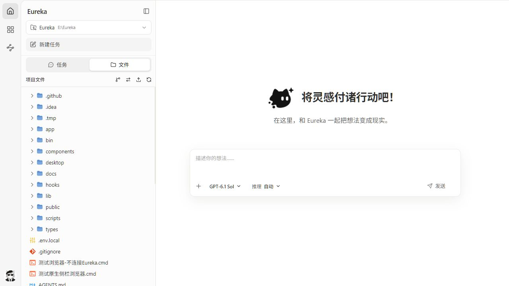

# Eureka

**把 AI 对话、项目文件、业务插件和自动化应用放在同一个工作台。**

[English](./README.md) · [日本語](./README.ja.md) · [Русский](./README.ru.md)

Eureka 是基于 [pi coding agent](https://github.com/earendil-works/pi) 的本地 AI 工作台，提供 **Windows 桌面端和浏览器界面**。你可以让 AI 阅读项目、修改代码和处理文件，也可以连接组织提供的业务工具，把重复操作做成可反复运行的自动化应用。

会话和配置保存在本机，并与 pi 共用。模型推理和业务查询使用你配置的模型服务及插件服务。

[下载安装包](https://github.com/is-zoop/Eureka/releases) · [从源码启动](#从源码启动) · [开始使用](#开始使用) · [反馈问题](https://github.com/is-zoop/Eureka/issues)



## 可以用来做什么

- **处理项目任务**：选择工作目录，让 AI 解释代码、排查问题、修改文件，并在对话中查看执行过程。
- **使用业务工具**：登录 Haze 后，从插件市场安装组织开放的 Skill、MCP 工具或自动化应用，在对话中选择并使用。
- **复用重复工作**：用自然语言描述文件整理、数据处理或网页操作需求，生成、试运行并保存为自动化应用；之后填写参数即可再次执行。

例如，你可以这样开始：

> 阅读当前项目，告诉我主要模块分别负责什么，并指出启动入口。

> 根据我选择的文件，整理一份数据摘要，并把结果保存到项目目录。

> 创建一个接收文本列表的自动化应用：去掉空项和重复项，排序后导出 JSON。先试运行并核对结果，再让我保存。

文件处理能力取决于所选模型、工具和插件；业务查询需要对应插件及访问权限。自动化创建和网页执行仍在持续迭代，具体任务应先用少量数据试运行。

## 主要功能

<table border="1" cellpadding="8" cellspacing="0" width="100%">
  <thead>
    <tr>
      <th align="left">功能</th>
      <th align="left">你可以做什么</th>
    </tr>
  </thead>
  <tbody>
    <tr>
      <td><strong>AI 对话</strong></td>
      <td>流式查看回复、思考与工具调用，选择模型和思考级别，回答澄清问题，使用计划模式梳理任务</td>
    </tr>
    <tr>
      <td><strong>项目与会话</strong></td>
      <td>按项目管理历史对话，继续、重命名、导出、删除会话，查看上下文占用与用量统计</td>
    </tr>
    <tr>
      <td><strong>对话分支</strong></td>
      <td>从历史消息创建独立新会话，或在当前会话内从某处编辑、继续并切换分支</td>
    </tr>
    <tr>
      <td><strong>文件与 Git</strong></td>
      <td>添加文件、文件夹和图片引用，浏览项目文件、查看 Git Diff，预览源码、Markdown、图片、音频、PDF 和 DOCX</td>
    </tr>
    <tr>
      <td><strong>多模型配置</strong></td>
      <td>管理 Provider 登录与 API Key，配置自定义模型，发现上游模型并测试连接</td>
    </tr>
    <tr>
      <td><strong>插件与技能</strong></td>
      <td>使用 Haze 组织插件市场，管理插件和技能，在输入框选择能力，并查看当前会话的 MCP 状态</td>
    </tr>
    <tr>
      <td><strong>自动化应用</strong></td>
      <td>在对话中创建、试运行、校验和保存应用；通过参数表单运行，查看流程画布、日志、结果及下载文件；支持 ZIP 导入导出与 AI 修改</td>
    </tr>
    <tr>
      <td><strong>桌面工作区</strong></td>
      <td>在侧边内置浏览器中处理网页任务，管理独立浏览环境和登录数据，使用系统托盘与应用内更新</td>
    </tr>
    <tr>
      <td><strong>Git worktree</strong></td>
      <td>创建和切换工作副本，同一仓库不同 worktree 的会话仍归在同一项目下</td>
    </tr>
  </tbody>
</table>

界面支持简体中文、英文、浅色与深色主题。

## 快速开始

### Windows 桌面端

适合希望直接使用完整工作区、内置浏览器和网页自动化的用户。

1. 打开 [Releases](https://github.com/is-zoop/Eureka/releases)，下载 Windows x64 安装包（`*-setup.exe`）并安装。
2. 启动 Eureka，选择 **使用 Haze 登录**，或点击 **跳过登录**先体验基础聊天与项目文件功能。
3. 打开 **设置 → 模型**，登录模型 Provider 或添加 API Key，并选择可用模型。
4. 新建任务、选择工作目录，输入需求即可开始。

安装包自带本地服务与 Node.js 运行时，使用时无需单独安装 Node.js 或 pi CLI。Haze 登录用于组织能力，模型 Provider 登录用于模型调用，两者需分别配置。

关闭桌面窗口后，Eureka 会留在系统托盘；选择托盘菜单中的 **退出 Eureka**可完全退出。后续可通过 **帮助 → 检查更新**或左侧更新入口获取新版本。

### 从源码启动

需要 **Node.js ≥ 22.19.0**、npm 和 Git，无需预先全局安装 pi。

```bash
git clone https://github.com/is-zoop/Eureka.git
cd Eureka
npm install
npm run dev
```

浏览器访问 [http://127.0.0.1:8080](http://127.0.0.1:8080)。本文统一使用 **8080** 端口。

<table border="1" cellpadding="8" cellspacing="0" width="100%">
  <thead>
    <tr>
      <th align="left">启动方式</th>
      <th align="left">命令或入口</th>
      <th align="left">端口</th>
    </tr>
  </thead>
  <tbody>
    <tr>
      <td><strong>源码开发</strong></td>
      <td><code>npm run dev</code></td>
      <td><code>8080</code></td>
    </tr>
    <tr>
      <td><strong>已构建的 Web 服务</strong></td>
      <td><code>npm run start</code></td>
      <td><code>8080</code></td>
    </tr>
    <tr>
      <td><strong>桌面开发</strong></td>
      <td><code>npm run desktop:dev</code></td>
      <td><code>8080</code></td>
    </tr>
    <tr>
      <td><strong>CLI（需要构建产物）</strong></td>
      <td><code>npx --package=. eureka --port 8080</code></td>
      <td>显式指定 <code>8080</code></td>
    </tr>
  </tbody>
</table>

没有 Haze 配置时，可以在登录页点击 **跳过登录**，配置模型后使用基础聊天。插件市场、自动化应用和需要组织身份的浏览器功能需 Haze 登录；网页自动化应用的执行还需要 Windows 桌面端。

需要运行插件内置 Chromium 浏览器时，另行安装匹配的浏览器：

```bash
npm run browser:install
```

这一步服务于 Playwright 浏览器功能；桌面原生网页视图使用 WebView2。Linux 上的 Chromium 还需要相应系统依赖。

## 开始使用

### 1. 发起第一次任务

在侧边栏新建任务并选择项目目录；在输入框选择模型和思考级别，描述要完成的工作。通过附件菜单或拖放添加文件、文件夹和图片作为上下文。

当前会话菜单提供禁用工具、只读、默认和全部四种工具预设。希望先了解项目时可选择只读；需要 AI 修改文件或执行命令时，选择与任务相符的工具权限。新会话默认权限可在设置中调整。

历史对话会按项目保留。你可以继续原对话，也可以从较早消息创建新会话或在原会话内编辑分支。

### 2. 使用插件

登录 Haze 后，进入扩展页面查看当前账号可访问的插件，选择项目或全局范围安装。回到对话，在输入框的添加菜单或 `/` 命令搜索中选择插件或技能，再补充需求。

插件可以提供业务知识、MCP 工具或可运行应用。例如，安装相应的数据查询插件后，可以在当前对话中选取数据并继续提问。可用能力由你的组织、插件服务和账号权限决定。

安装或更新后，新会话使用最新配置；已有会话按界面提示在空闲时重载。对话底部的 MCP 状态入口可查看服务连接与工具数量。

### 3. 创建和运行自动化

自动化适合需要反复执行、输入输出较明确的任务。

<table border="1" cellpadding="8" cellspacing="0" width="100%">
  <thead>
    <tr>
      <th align="left">目标</th>
      <th align="left">操作</th>
    </tr>
  </thead>
  <tbody>
    <tr>
      <td><strong>创建新应用</strong></td>
      <td>在首页新对话选择“自动化”，或输入 <code>/automation</code> 并描述需求</td>
    </tr>
    <tr>
      <td><strong>使用已保存应用</strong></td>
      <td>进入“自动化”目录选择应用，或在聊天的插件命令中搜索应用名称</td>
    </tr>
    <tr>
      <td><strong>导入应用</strong></td>
      <td>“自动化”侧栏标题右侧菜单 → 导入应用包，选择 ZIP 并确认安装</td>
    </tr>
    <tr>
      <td><strong>查看记录、修改或导出</strong></td>
      <td>对应应用右侧的“…”菜单</td>
    </tr>
  </tbody>
</table>

创建时，AI 会按需要询问参数、生成应用并试运行；你负责选择文件、完成网站登录及必要授权。核对实际结果和校验项，通过后点击 **保存到自动化目录**。

使用时，在应用配置中填写参数、选择文件及浏览环境，点击 **开始运行**；也可以在对话中选择已保存应用并提出运行需求。执行过程会展示流程画布、日志和结果，生成的文件可下载。`/automation` 用于创建新应用，选择应用名称用于调用已有应用。

支持本地脚本、网页操作和包含 AI 步骤的应用；具体能力以应用声明和实际校验结果为准。网页任务在桌面内置浏览器中进行，登录及验证码需要人工处理。浏览环境可在 **设置 → 浏览器管理**中维护。

## 配置与数据

### 模型与本地数据

模型可直接在 **设置 → 模型**中配置。已有 pi 用户会复用同一本机目录，无需导入历史会话。

<table border="1" cellpadding="8" cellspacing="0" width="100%">
  <thead>
    <tr>
      <th align="left">位置</th>
      <th align="left">内容</th>
    </tr>
  </thead>
  <tbody>
    <tr>
      <td><code>~/.pi/agent/sessions/</code></td>
      <td>本地会话历史</td>
    </tr>
    <tr>
      <td><code>~/.pi/agent/settings.json</code></td>
      <td>默认模型和 pi 设置</td>
    </tr>
    <tr>
      <td><code>~/.pi/agent/models.json</code></td>
      <td>自定义模型配置</td>
    </tr>
    <tr>
      <td><code>~/.pi/agent/auth.json</code></td>
      <td>模型 Provider 凭据</td>
    </tr>
    <tr>
      <td><code>~/.pi/agent/plugins/automation/</code></td>
      <td>已安装自动化应用代码</td>
    </tr>
    <tr>
      <td><code>~/.pi/agent/app-data/</code></td>
      <td>按用户保存的自动化配置、运行记录及产物</td>
    </tr>
  </tbody>
</table>

可通过环境变量 `PI_CODING_AGENT_DIR` 指定其他 agent 数据目录。与 pi 共用会话时，需要在同一文件系统环境中运行，并能访问会话对应的工作目录。

自动化应用包与个人运行数据分开保存；ZIP 导出按发布清单生成。卸载默认保留应用数据，也可在确认时选择删除；卸载后保留的数据可在 **设置 → 自动化管理**中清理。

### Haze 登录（源码部署）

只使用基础聊天时可以跳过此配置。需要组织插件和自动化时，在项目根目录创建 `.env.local`，填写由 Haze 管理员提供的 OIDC 配置：

```dotenv
EUREKA_AUTH_PROVIDER=haze-oidc
EUREKA_AUTH_HAZE_ISSUER=https://your-haze.example.com
EUREKA_AUTH_CLIENT_ID=your-client-id
EUREKA_AUTH_REDIRECT_URI=http://127.0.0.1:8080/api/marketplace-auth/callback/haze
EUREKA_AUTH_SESSION_SECRET=replace-with-a-long-random-secret
```

会话密钥至少 32 个字符。可运行 `node -e "console.log(require('node:crypto').randomBytes(32).toString('hex'))"` 生成随机值。回调地址需与 Haze 注册配置一致；修改后重启开发服务。桌面打包的公开登录配置见 [桌面端文档](./desktop/README.md)。

### 网络代理与 CLI

服务端模型和 API 请求支持 `HTTP_PROXY`、`HTTPS_PROXY`、`NO_PROXY`。例如在 Windows PowerShell 中，先设置环境变量，再启动服务：

```powershell
$env:HTTP_PROXY = "http://127.0.0.1:7890"
$env:HTTPS_PROXY = "http://127.0.0.1:7890"
$env:NO_PROXY = "localhost,127.0.0.1"
npm run dev
```

已包含生产构建产物的项目目录也可通过 CLI 启动；它不能直接运行未构建源码：

```bash
npx --package=. eureka --port 8080
```

<table border="1" cellpadding="8" cellspacing="0" width="100%">
  <thead>
    <tr>
      <th align="left">CLI 参数 / 环境变量</th>
      <th align="left">用途</th>
      <th align="left">本文使用值</th>
    </tr>
  </thead>
  <tbody>
    <tr>
      <td><code>--port</code> / <code>-p</code> / <code>PORT</code></td>
      <td>服务端口</td>
      <td><code>8080</code>（通过 <code>--port 8080</code> 指定）</td>
    </tr>
    <tr>
      <td><code>--hostname</code> / <code>-H</code> / <code>PI_WEB_HOSTNAME</code></td>
      <td>监听地址</td>
      <td><code>127.0.0.1</code></td>
    </tr>
    <tr>
      <td><code>--no-open</code> / <code>PI_WEB_NO_OPEN=1</code></td>
      <td>关闭自动打开浏览器</td>
      <td>自动打开</td>
    </tr>
    <tr>
      <td><code>PI_WEB_ALLOWED_HOSTS</code></td>
      <td>额外允许的精确主机名，逗号分隔</td>
      <td>未设置</td>
    </tr>
    <tr>
      <td><code>PI_WEB_PASSWORD</code></td>
      <td>HTTP Basic Auth 密码，用户名为 <code>pi</code></td>
      <td>未启用</td>
    </tr>
  </tbody>
</table>

命令行参数优先于对应环境变量。CLI 代码仍保留 `30141` 作为未指定端口时的兼容默认值；上面的命令显式传入 `8080`，与源码服务及 Haze 回调地址保持一致。本地使用保持回环监听；远程部署应配合 HTTPS 或可信 VPN 与访问认证，Basic Auth 本身不加密传输。

## 开发与文档

技术栈：**Next.js 16 · React 19 · TypeScript · pi Agent SDK · Tauri 2（Windows）**。

```bash
npm test
npx tsc --noEmit
npm run lint
```

**日常开发不要运行 `next build` 或 `npm run build`**，它们会写入 `.next/` 并干扰开发服务。生产构建和打包按发布文档执行。

桌面开发还需要 Rust stable、Windows C++ Build Tools 和 WebView2；安装桌面依赖后启动：

```bash
npm install --prefix desktop
npm run desktop:dev
```

此命令会同时启动开发服务和桌面窗口；先停止占用 8080 端口的独立开发服务。

```text
app/          页面与 API 路由
components/   对话、文件、设置、插件及自动化界面
hooks/        会话、流式事件和交互状态
lib/          Agent、会话、模型、插件、浏览器和自动化逻辑
desktop/      Tauri 桌面外壳与打包脚本
public/       静态资源与 PWA 文件
bin/          CLI 启动入口
docs/         专题说明与开发文档
```

- [桌面端开发与更新](./desktop/README.md) · [发布流程](./docs/release.md)
- [自动化应用](./docs/automation-apps.md) · [对话调用应用](./docs/automation-chat.md)
- [组织插件](./docs/organization-plugins.md) · [浏览器管理](./docs/browser-management.md)
- [Git worktree](./docs/worktrees.zh-CN.md) · [国际化](./docs/i18n.md)
- [架构与开发约定](./AGENTS.md)

## 许可证与致谢

采用 [MIT 许可证](./LICENSE)。感谢 [pi](https://github.com/earendil-works/pi) 提供 Agent SDK 与会话基础，以及 [pi-web](https://github.com/agegr/pi-web) 的原始 Web 界面工作。
